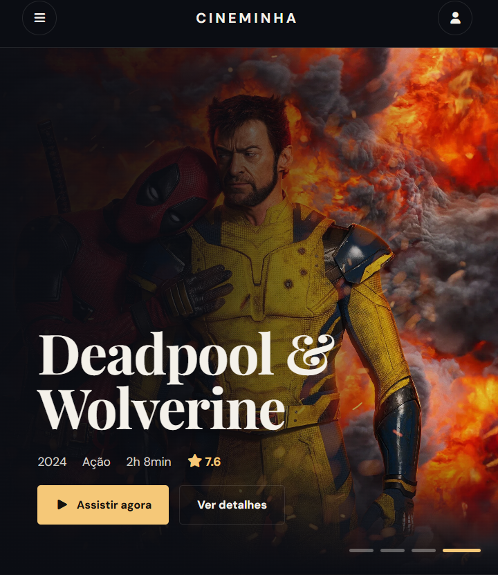
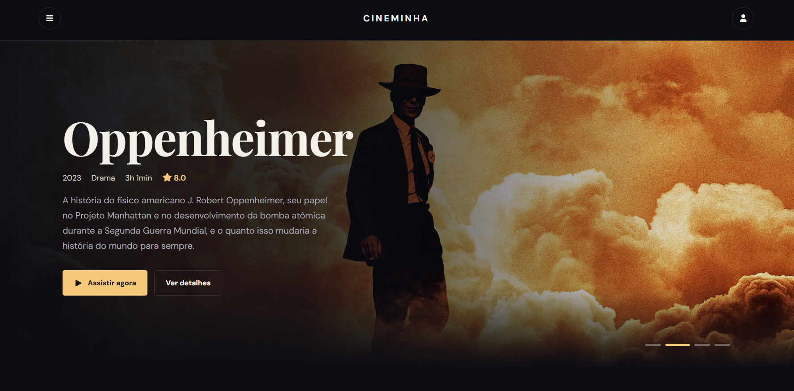
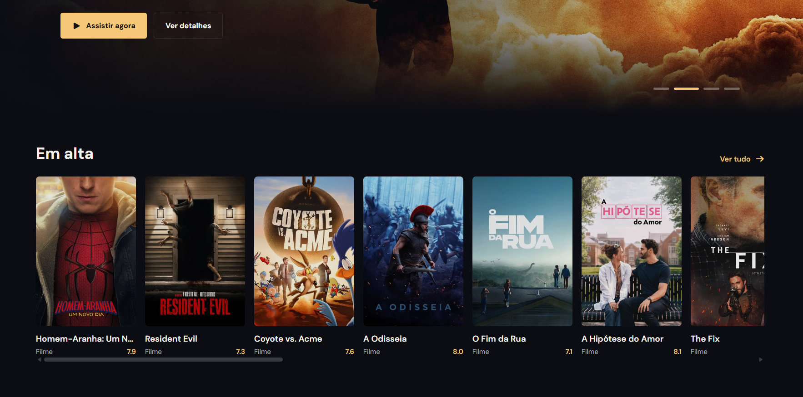

# CINEMINHA

CINEMINHA é um catálogo de filmes e séries desenvolvido com HTML, CSS e JavaScript. Os dados, pôsteres, imagens de fundo, logos, trailers, elenco e episódios são obtidos da API do The Movie Database (TMDB).

## Visualização

<p align="center">
  
  
  
</p>

## Tecnologias

- HTML5
- CSS3
- JavaScript
- TMDB API
- Font Awesome
- Google Fonts

## Funcionalidades

### Página inicial

- Slider de filmes em destaque com troca automática.
- Indicadores clicáveis para navegar entre os destaques.
- Clear logo dos filmes em destaque.
- Backdrop e informações do filme atual.
- Botão **Visualizar** levando para a página de detalhes.
- Listas horizontais de filmes em alta, filmes avaliados e séries populares.
- Navegação lateral responsiva.
- Ícone de pesquisa no cabeçalho.

### Detalhes de filmes

- Pôster e backdrop do filme.
- Clear logo quando disponível.
- Título original, ano, duração, avaliação e gêneros.
- Sinopse e status.
- Idioma original.
- Direção e orçamento.
- Trailer do YouTube.
- Elenco com cards horizontais.
- Lista de filmes recomendados.

### Detalhes de séries

- Pôster e backdrop da série.
- Clear logo quando disponível.
- Título original, ano, avaliação e gêneros.
- Sinopse e status.
- Idioma original.
- Criadores e quantidade de temporadas.
- Trailer do YouTube.
- Elenco com cards horizontais.
- Seletor de temporadas.
- Episódios com imagem, número, nome, duração ou data de exibição e descrição.
- Lista horizontal de séries recomendadas.

## Estrutura do projeto

```text
movieverse/
├── assets/
│   └── images/
│       ├── img1.png
│       ├── img2.png
│       └── img3.png
├── css/
│   ├── style.css
│   └── details.css
├── js/
│   ├── api.js
│   ├── app.js
│   ├── config.js
│   └── details.js
├── index.html
├── movie-details.html
├── serie-details.html
└── README.md
```

## Configuração da chave TMDB

O projeto utiliza a API v3 do [The Movie Database](https://www.themoviedb.org/).

1. Crie uma conta no TMDB.
2. Acesse as configurações da API em `https://www.themoviedb.org/settings/api`.
3. Solicite ou copie sua chave de API v3.
4. Abra `js/config.js` e substitua o valor da chave:

```javascript
const TMDB_API_KEY = "SUA_CHAVE_AQUI";
```

A chave é compartilhada pelos arquivos `js/api.js` e `js/details.js`, portanto não é necessário repetir a configuração em cada arquivo.

## Como executar

### Opção 1: abrir diretamente

Abra `index.html` em um navegador moderno.

Alguns navegadores restringem requisições ou caminhos quando o arquivo é aberto diretamente. Para evitar esses problemas, utilize um servidor local.

### Opção 2: Live Server

1. Instale a extensão **Live Server** no Visual Studio Code.
2. Abra a pasta do projeto.
3. Clique com o botão direito em `index.html`.
4. Selecione **Open with Live Server**.

## Rotas internas

```text
index.html
movie-details.html?id=ID_DO_FILME&type=movie
serie-details.html?id=ID_DA_SERIE&type=tv
```

Os parâmetros `id` e `type` são usados pelo `js/details.js` para selecionar os dados e os endpoints adequados do TMDB.

## Créditos

Este projeto utiliza a API e imagens disponibilizadas pelo [The Movie Database (TMDB)](https://www.themoviedb.org/).

Este produto utiliza a API do TMDB, mas não é endossado nem certificado pelo TMDB.

## Licença

Projeto desenvolvido para fins de estudo e prática de desenvolvimento web.
